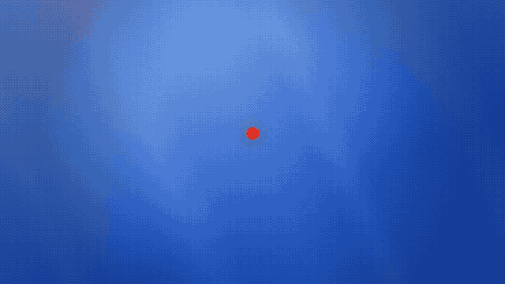
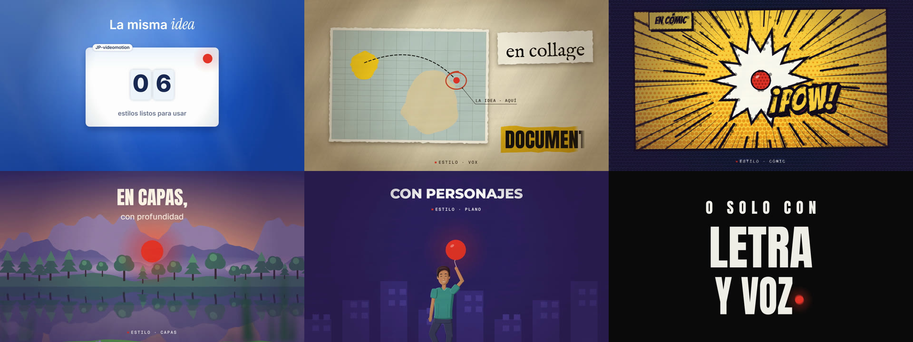

# JP-videomotion

**Un estudio de video que manejas conversando con tu agente de IA.** Le dices «nuevo video», te hace las preguntas justas
y lo produce contigo fase por fase: guion, voz, diseño, animación, música, subtítulos y entrega. Tú apruebas cada paso.

<p align="center">
  
</p>

<p align="center">
  <a href="videos/001-promo-jp-videomotion/entregables/final/final_16x9.mp4"><b>▶ Ver el video promocional completo</b></a>
  (16:9 · <a href="videos/001-promo-jp-videomotion/entregables/final/final_9x16.mp4">versión vertical 9:16</a>),
  hecho de principio a fin con este repo.
</p>

## Qué hace
- **Convierte una idea en un video terminado** sin abrir un editor de video: el agente escribe, anima y renderiza.
- **Cualquier estilo con el mismo flujo**: tipografía cinética, tarjetas, collage documental, cómic, paisajes 2.5D o
  personajes planos, con tu marca (colores, tipografías, logo).
- **Tú decides**: en cada compuerta (guion, voz, diseño, storyboard…) te muestra el resultado y espera tu aprobación.
- **Vertical y horizontal** desde la misma línea de tiempo, con un render reproducible cuadro a cuadro.

## Empieza en 3 pasos
1. Abre tu agente de IA (Claude Code, u otro que lea `AGENTS.md`) en la carpeta donde quieras el proyecto y dile:
   > Clona `https://github.com/josephprada/JP-videomotion` aquí y configúralo.
2. El agente revisa tu equipo, te dice cómo instalar lo que falte y te pregunta si lo quieres **todo por defecto o a tu medida**.
3. Abre el agente **dentro de la carpeta del proyecto** y dile **«nuevo video»**. Desde ahí, solo respondes y apruebas.

## Qué pasa cuando pides un video
```
entrevista → guion → voz → tiempos → diseño → storyboard → animatic → producción → sonido → render → subtítulos → entrega
    ⛔        ⛔      ⛔                ⛔         ⛔           ⛔                                                       ⛔
```
⛔ = compuerta: el agente se detiene, te muestra el resultado y espera tu «sí». Si cambias algo de una fase anterior,
el video vuelve a esa fase y rehace solo lo necesario. Cada video vive en su carpeta (`videos/NNN-nombre/`) y se
puede retomar en cualquier momento. Las fases y compuertas exactas dependen del tipo de video (perfil).

## Seis estilos, una misma idea
<p align="center"></p>

| Estilo | Cómo se ve | Para qué sirve |
| --- | --- | --- |
| `tipografico` | Tipografía cinética sincronizada con la voz (12 efectos de glifo) | Frases que pegan, ensayos, ganchos |
| `tarjetas` | Tarjetas que entran enfocándose, contadores, insignias | Datos, comparativas, producto |
| `vox` | Collage documental: papel, recortes, mapas, rotulador | Historia, explicadores con fuentes |
| `comic` | Viñetas, semitono, onomatopeyas, personajes «en dos» | Humor, relatos con energía |
| `capas` | Paisajes 2.5D con paralaje, niebla y reflejos | Ambiente, viajes, narración pausada |
| `plano` | Personajes y escenarios planos sobre un rig | Historias con personajes |

¿Quieres otro? `estilos/_nuevo/` explica cómo crear el tuyo.

---

## Detalles técnicos

### Requisitos
Node.js 20+, ffmpeg, Google Chrome (o Chromium/Edge), git y bash (en Windows viene con Git for Windows).
Opcionales: whisper.cpp (tiempos por palabra y subtítulos), git-lfs (videos finales), Python con librosa (pistas de
música entregadas). `node nucleo/jp.mjs doctor` revisa el equipo y dice cómo instalar lo que falte en tu sistema.

### Cómo funciona el render
Cada escena es una página HTML con un `<canvas>` que dibuja **en función del tiempo**: `window.seek(t)` pinta el cuadro
exacto del segundo `t`, sin estado entre cuadros. `nucleo/render.mjs` abre la escena en Chrome con Playwright, pide
cada cuadro (60 fps, con submuestreo para el desenfoque de movimiento) y se los pasa a ffmpeg. Por eso:
- el mismo código da el mismo video (con `--raster software`, idéntico entre procesos; `nucleo/tools/determinismo.sh` lo comprueba);
- 9:16, 16:9 y 1:1 salen de la misma línea de tiempo (`--fmt`);
- los tiempos se escriben en segundos de la voz, así cada golpe visual cae en su palabra (`voz/palabras.srt`).

### Cómo está organizado
```
AGENTS.md            instrucciones para cualquier agente · CLAUDE.md: soporte extra para Claude
flujos/              procedimientos paso a paso: bootstrap, nuevo video, producir, sistema de diseño
perfiles/            QUÉ tipo de video y sus fases: libre, historia-narrada, explicador, promo-lanzamiento, tutorial
metodos/             CÓMO se produce: canvas (estable), hyperframes y generativo (experimentales)
estilos/             CÓMO se ve: los seis estilos y _nuevo/ para crear uno
sistemas-diseno/     la MARCA: colores, tipografías, logos (desde Claude Design, Figma, un manual o a mano)
universos/           personajes y escenarios que se repiten entre videos
videos/              una carpeta por video con estructura fija; _plantilla/ es la base
nucleo/              motor genérico: CLI, render, kit de animación, herramientas, typefx
```
Las reglas se aplican en este orden (lo de la derecha sobrescribe a lo de la izquierda): `nucleo/CONTRATO.md`
(inviolable) → `jp.config.yaml` → perfil → método → estilo → sistema de diseño → el video.

### Kit de animación (`nucleo/kit/`)
| Módulo | Qué aporta |
| --- | --- |
| `foco` | Entradas y salidas por desenfoque, profundidad de campo, texto «karaoke» |
| `ui` | Contadores, odómetros, tarjetas, insignias, conectores, ondas |
| `collage` | Papel, recortes rasgados, marcador, rótulos, retícula de mapa, tono de archivo |
| `capas` | Paralaje, perfiles de montaña, atmósfera, niebla, rayos, reflejos |
| `comic` | Semitono, viñetas, impactos, líneas de foco, onomatopeyas, globos |
| `rig` | Personajes articulados con IK, ciclo de caminar y expresiones |
| `camara`, `luz`, `dibujo`, `acabado`, `armazon`, `fuentes` | Cámara, luz, formas, grano y viñeta, armazón de escena, carga de fuentes |

La tipografía cinética usa [typefx](https://github.com/lorena-bordonaba-pau/typefx) (incluido en `nucleo/vendor/typefx`).

### CLI
```bash
node nucleo/jp.mjs doctor                 # requisitos del equipo
node nucleo/jp.mjs catalogo               # perfiles, estilos, métodos, sistemas de diseño, universos y videos
node nucleo/jp.mjs nuevo <slug> [...]     # crea videos/NNN-slug
node nucleo/jp.mjs estado <video>         # fases, la actual y qué leer
node nucleo/jp.mjs completar|reabrir <video> <fase>
node nucleo/jp.mjs subtitulos <video> [--quemar]
node nucleo/jp.mjs servir                 # vista previa en vivo de las escenas
bash nucleo/tools/video.sh <video> final [16x9]   # render final de todas las escenas con su audio
```
Con Claude Code, los flujos también son skills: `/jp-bootstrap`, `/jp-nuevo-video`, `/jp-producir` y `/jp-sistema-diseno`.

### Voz, música y subtítulos
- **Voz**: TTS (p. ej. ElevenLabs) o grabación propia; el agente prepara el texto con etiquetas de emoción.
- **Música y efectos**: sintetizados en código para cada video (`montaje/audio/sintesis.cjs`) o una pista entregada;
  mezcla con la música bajo la voz a −14 LUFS (`nucleo/tools/mezcla.sh`).
- **Subtítulos**: `.srt` para subir a la plataforma o quemados en el video, a partir de los tiempos de la voz.

### Usarlo para tu canal
Puedes trabajar en un repo propio y seguir recibiendo mejoras: agrega este repo como remoto `upstream` y trae los cambios
con `git pull upstream main`. Tus videos, perfiles y marca viven en tu repo; el motor se actualiza desde aquí.

### Pruebas
```bash
cd nucleo && npm test     # el kit y las librerías del núcleo
```

### Capacidades opcionales
- [HyperFrames](https://github.com/heygen-com/hyperframes) para el método `hyperframes`.
- [jp-skill-image](https://github.com/josephprada/jp-skill-image) para generar ilustraciones (recomendada en `vox`).
- Conectores de Claude Design o Figma para importar tu sistema de diseño.

## Hecho con JP-videomotion
- [`videos/001-promo-jp-videomotion/`](videos/001-promo-jp-videomotion/): el video de arriba, con su brief, guion,
  storyboard, escenas, sonido y entrega.

## Créditos
- Tipografía cinética: [typefx](https://github.com/lorena-bordonaba-pau/typefx) de Lorena Bordonaba (MIT).
- Fuentes de [Fontsource](https://fontsource.org) (SIL Open Font License): Anton, Bangers, Geist, Geist Mono, Inter,
  Montserrat, Mrs Saint Delafield y otras; Anybody y JetBrains Mono incluidas en typefx.

## Licencia
MIT (ver `LICENSE`).
